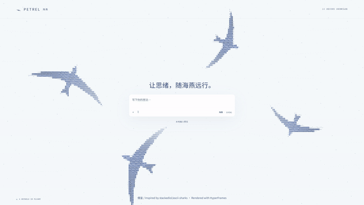

# Agent Petrel · 海燕

把 ASCII 鲨鱼的视觉想法改成海燕：展翅、振翅、迎风盘旋，背景里只有海燕，没有鲨鱼。面向 agent 界面的独立 TypeScript / Canvas 组件，**零运行依赖、离线可用**。

**借鉴 / Inspired by [stackedlol/ascii-sharks](https://github.com/stackedlol/ascii-sharks)。** 感谢原项目展示 ASCII 动物与粒子环境的表现方式；这里重新实现了海燕形状、飞行动作和通用组件。

## 10 秒展示



[观看 1080p / 30fps MP4](media/agent-petrel-10s.mp4) · [HyperFrames 视频工程](showcase/) · [下载可直接运行的打包版本](https://github.com/zuomeizuoyang/agent-petrel/releases/latest)

视频使用项目自身的 DOM、CSS 和 Canvas 引擎，由 HyperFrames 导出。浅色聊天布局、4 只海燕、无声，时长 10 秒。视频展示独立组件效果。

## 先看效果

- 直接用浏览器打开 `dist/petrel-preview.html`：自包含文件，不需要安装依赖。
- 或运行 `node scripts/serve.mjs`（Windows 可双击 `Start-Petrel.cmd`），访问 `http://127.0.0.1:4187`。仅监听本机，Ctrl+C 停止。
- `?embed=1` 进入无界面的纯背景模式，例如 `http://127.0.0.1:4187/?embed=1&theme=moon&count=4`。
- `?view=chat` 是按用户 X 视频核对后补充的浅色聊天布局：四只大幅海燕、蓝色字符方块、中央输入区。入口为 `http://127.0.0.1:4187/?view=chat`，或在离线 HTML 文件地址末尾加 `?view=chat`。这是本地效果预览，不连接聊天模型。
- 控制台可调数量、速度、亮度、配色、模拟 agent 状态，配置可导出 JSON。它不会自动读取真实 agent 的工作状态。

## 当前 Codex 桌面的实际状态

**可在当前聊天侧栏运行预览；尚未替换 Codex 整块聊天背景。** 当前检查到的官方 Appearance 设置支持配色、字体等，没有找到用于加载自定义 Canvas / HTML 动态背景的公开接口。浏览器扩展也不能注入原生 Codex 窗口。本项目没有修改 Codex 安装文件、账户或设置。

因此这是“统一渲染引擎 + 按宿主接入”的项目，而不是已支持任意 agent 客户端的一键换肤工具。已实现与未实现的边界见 `docs/INTEGRATIONS.md`。

## 接入自己的网页 / agent

构建产物 `dist/sdk/petrel.global.js` 可直接加载：

```html
<script src="./sdk/petrel.global.js"></script>
<style>
  .workspace { position: relative; isolation: isolate; min-height: 100vh; }
  .content { position: relative; z-index: 1; }
</style>
<div class="workspace">
  <petrel-background count="5" speed="0.65" theme="storm"></petrel-background>
  <div class="content">你的 agent 界面</div>
</div>
```

或导入 ES module，直接控制 Canvas：

```js
import { PetrelEngine } from './sdk/petrel.js';
const engine = new PetrelEngine(canvas, { count: 4, transparent: true });
engine.configure({ state: 'working', theme: 'moon' });
engine.pause();
engine.resume();
// 视频导出：暂停实时播放，并定位到可重复的第 4 秒画面：
engine.renderAt(4);
// 组件 / 页面卸载时：
engine.destroy();
```

也可使用 `mountPetrel(host, options)` 自动挂载 Web Component。调用者负责设置宿主高度、定位和前景内容层级；重复挂载同一宿主会返回已有组件。组件没有自动的宿主样式修改，方便 React / Vue / WebView 复用。

React 中在 `useEffect` 里创建 `PetrelEngine`，返回 `() => engine.destroy()` 即可；Vue 对应 `onMounted` / `onBeforeUnmount`。SDK 必须在浏览器环境中加载；SSR 时请动态导入。

### 参数

| 属性 / 选项 | 默认值 | 范围 / 意义 |
| --- | --- | --- |
| `count` | 5 | 0–12 只 |
| `speed` | 0.65 | 0–3 倍，0 保持静止但仍刷新 |
| `opacity` | 0.8 | 0–1，鸟与环境的亮度 |
| `scale` | 1 | 0.3–2，鸟的尺寸 |
| `fps` | 30 | 1–60 帧/秒上限 |
| `theme` | storm | storm / moon / dawn / day（浅色） |
| `texture` | tiles | tiles（字符方块）/ glyphs（纯字符） |
| `center-clear` / `centerClear` | 0.7 | 0–1，中央阅读与输入区域的柔和留白强度 |
| `state` | idle | idle / working / waiting / done，由宿主主动设置 |
| `interactive` | true | 在附近避开鼠标，不接管点击 |
| `transparent` | false | 不绘制底色 |
| `reduced-motion` / `reducedMotion` | false | 强制静态帧；始终尊重系统减少动态设置 |
| `seed` | 87 | 可重复的初始鸟群布局 |
| `paused` | 不存在 | Web Component 布尔属性；暂停后可移除此属性恢复 |

布尔属性可写 `transparent` 或 `transparent="true"`，显式关闭用 `transparent="false"`。非法数值会使用默认值，越界数值会被限制。通过 `element.controller` 获取引擎。移除 Web Component 会清理 RAF、Observer 和事件监听器。

## 现有 agent 网页的浏览器扩展

1. Chrome / Edge 打开扩展管理页，开启开发者模式。
2. “加载解压缩的扩展”选择 **`dist/extension`**。
3. 在普通 HTTP(S) agent 网页上点击扩展图标，再点一次移除。

扩展只申请 `activeTab` 和 `scripting`，由你点击后才运行；无全站常驻授权、不读取页面正文、不发送数据。它采用**位于页面上方的透明装饰层**，中央留空，指针完全穿透；并不强制改变第三方网页 DOM 或真正替换底色。根据宿主背景色选择日间 / 夜间海燕，宿主的渐变、复杂层级仍可能影响效果。刷新后关闭，需再次点击。

## 开发与验证

需要 Node.js 20.19+ 或 22.12+。

```powershell
npm ci
npm run dev
npm run build
npm test
npm run showcase:prepare
npm run showcase:check
npm run showcase:render
```

测试默认使用 Windows Edge。其他系统或 Chromium 路径通过 `PETREL_BROWSER` 设置。Playwright E2E 覆盖持续绘制、暂停恢复、减少动态、数量参数、属性移除、移动布局、挂载清理、输入透传、离线文件以及扩展装饰层开关。具体本次执行结果见 `docs/VERIFICATION.md`。

## 来源

视觉参考：[stackedlol/ascii-sharks](https://github.com/stackedlol/ascii-sharks)，检查的提交 `c521e24a787e6d4cc460d4cf2b9815f25e4fe453`。参考仓库展示 Canvas 上的 ASCII 动物与粒子环境。海燕形状、飞行逻辑、组件、控制台和适配代码为本项目重新编写；未分发原仓库源码。原仓库本次未发现 LICENSE 文件，因此本项目 MIT 仅覆盖这里的新实现。

效果参考：[LerneKImitk 的浅色聊天界面演示](https://x.com/LerneKImitk/status/2112502617704427806?s=20) 和 [stackedlol 原始展示](https://x.com/stackedlol/status/2112257760628986188)。海燕版沿用浅色、大幅 ASCII 字符方块动物围绕中央输入区运动的视觉方向。

视频时间轴由 [HyperFrames](https://hyperframes.heygen.com/) 驱动；视频工程中使用的 GSAP 保留原版权声明和许可链接。项目 MIT 许可不替代第三方依赖各自的许可。

Codex 外观能力依据：[OpenAI 官方设置说明](https://learn.chatgpt.com/docs/reference/settings)，检查日期 2026-10-20。
